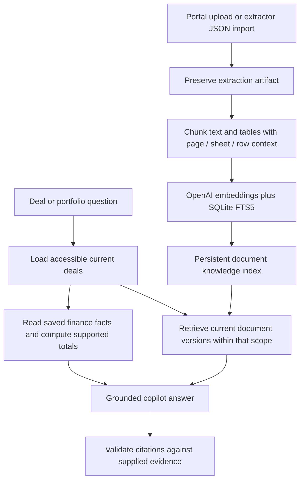

# Document knowledge and finance copilot

The copilot uses two sources: searchable document evidence and the current saved
deal records. Importing evidence does not change finance fields or mark values as
approved. Existing review/populate/save workflows remain the way to adopt values.

## Try it

1. Start the portal backend and frontend as described in the project README.
2. Open a saved deal as its owner, then **Portal Copilot → Documents → Document knowledge**.
3. Select a document JSON from `document-extractor/output/<run>/documents/`.
   Use the individual document JSON, not `manifest.json`. Optionally select the
   original PDF, Word, Excel, PowerPoint, or text file. Its SHA-256 must match the JSON.
4. Click **Import extraction**. The panel shows searchable and embedded chunk counts.
5. Ask “What are the payment terms?” or “What is the current customer finance FTE?”
6. For a revised file, choose **Replace: <document>** before importing. Replacement
   atomically removes old chunks from search. **Remove from search** removes an import.

Use the **Conversation** tab to chat. Enter sends a question; Shift + Enter adds a
new line. Expand **Sources** below an answer to see its evidence. The portfolio
copilot on All Deals also supports Escape to close and return focus to its launcher.

Existing portal uploads are indexed after successful extraction and backfilled
on the next chat request. **Rebuild document search** backfills/retries explicitly.
Legacy PDF extraction can contain only field evidence, and existing portal parsers
have coverage limits. Import the standalone extractor's JSON for its full extracted
text/tables/OCR. The original file is retained only if supplied; the separate extractor
does not automatically transfer its local files. An imported JSON remains unreviewed,
including when its extraction status is `ok`.

## Data flow



- `backend/data/knowledge.sqlite3`: document catalog, chunks, embeddings and full-text index.
- `backend/data/knowledge/<deal hash>/<document hash>/<version>/extraction.json`:
  full imported extraction JSON or portal parser artifact. Optional originals use `original.bin`.
- Existing deal SQL storage: saved finance values and workspace state, unchanged by imports.

This local vector store uses exact cosine scoring combined with lexical matching.
It needs no additional database service or native vector extension. It scans vectors
within the authorized scope; a large production corpus should move this interface
to an indexed vector engine. Removed/replaced artifact files remain on disk for
recovery but are excluded from search and the artifact download API. Physical
retention cleanup is not implemented.

## Configuration

In `backend/.env` (keys stay on the backend):

```dotenv
OPENAI_API_KEY=your-key
OPENAI_EMBEDDING_MODEL=text-embedding-3-small
KNOWLEDGE_TOP_K=8
KNOWLEDGE_IMPORT_MAX_BYTES=104857600
# Optional separate index location:
# KNOWLEDGE_DATABASE_PATH=backend/data/knowledge.sqlite3
```

The embedding request follows the [official OpenAI documentation](https://developers.openai.com/api/reference/python/resources/embeddings/methods/create).
Indexing sends extracted chunks to OpenAI; chat sends retrieved excerpts and relevant
saved facts. Indexing/query failures preserve keyword search and show a warning.
Rebuild after fixing credentials or changing the embedding model. TLS verification
uses the operating system's trusted certificate roots. Chat requests use `store=False`.

## Answers and permissions

Saved facts take priority for questions about current values. Document evidence and
review suggestions are labelled unreviewed; the model is instructed to disclose
conflicts. Saved values are not automatically described as formally approved.

The backend currently calculates exact portfolio sums for `customerFinanceFte` and
`financeCostBaseline`. It includes all accessible deals, reports missing/invalid
values, and groups baselines by currency. It does not calculate arbitrary revenue,
pricing, filtered totals, or unsaved frontend results. Those require additional
explicit calculation tools. Document top-k results are never an aggregation dataset.

Access comes from the existing server-side deal store. Owners can import, replace,
rebuild, and remove imports; authorized deal readers can search/download evidence.
SQL filters scope before vectors are loaded. Current portal manifests also filter
out changed/deleted documents. Chat messages are tagged with the current deal and
document versions and excluded when that context changes, including access revocation.
Source references with unknown locations or non-verbatim quotes are removed. These
checks do not guarantee every generated sentence is correct; important finance
decisions still require review.

The portal still uses its existing demo `X-User-Id` authentication. Signed sessions
or verified identity tokens are required before exposing this application to
untrusted users; this change does not replace the authentication system.

## API

All routes use `/api/deals/{deal_id}/knowledge` and existing user authentication.

| Method | Suffix | Purpose |
| --- | --- | --- |
| GET | (none) | Current index status |
| POST | `/import` | Multipart `extraction`, optional `original`, optional `replace_document_id` |
| POST | `/reindex` | Rebuild current sources and retry embeddings |
| DELETE | `/{document_id}` | Remove an imported document |
| GET | `/{document_id}/extraction` | Download current extraction JSON |
| GET | `/{document_id}/original` | Download original, when supplied |

Imports allow 100 MiB per file by default, independently of existing portal upload limits.
Import/rebuild requests are synchronous; large batches can take several minutes.

## Verification

From `backend/`:

```powershell
.\.venv\Scripts\python.exe -m unittest discover -s tests -v
```

Tests use temporary databases and synthetic evidence with fake embedding/chat
responses. They cover retrieval scope, source versions/deletion, semantic synonyms,
keyword fallback, import/download, matching originals, exact totals, citation
validation, and grounded chat inputs. No API key or real deal data is needed.

From the frontend project directory, run `npm run build`.

For an optional live embedding + chat check using synthetic data only (API usage
is billed), run from `backend/`:

```powershell
.\.venv\Scripts\python.exe scripts/check_knowledge.py --live
```

This creates a temporary index and checks that the answer cites a document's
45-day payment terms and distinguishes saved finance FTE 12 from document FTE 99.
It does not import test evidence into your real deals.

Verified on 13 November 2026: 26 backend tests passed; the frontend production build
passed (with its existing bundle-size warning). A live check using the configured
`gpt-4.1-mini` chat model and OpenAI embeddings returned 45-day payment terms,
identified the 12 versus 99 FTE conflict, and supplied both validated citations.
The live fixture and index were temporary. The revised copilot UI was also checked
in a browser at 1440 × 960, 900 × 900, 390 × 844, 360 × 640, and 667 × 375 with
synthetic API responses. Checks covered keyboard navigation, chat scrolling, long
filenames, import/removal controls, and the portfolio dialog's viewport bounds.
