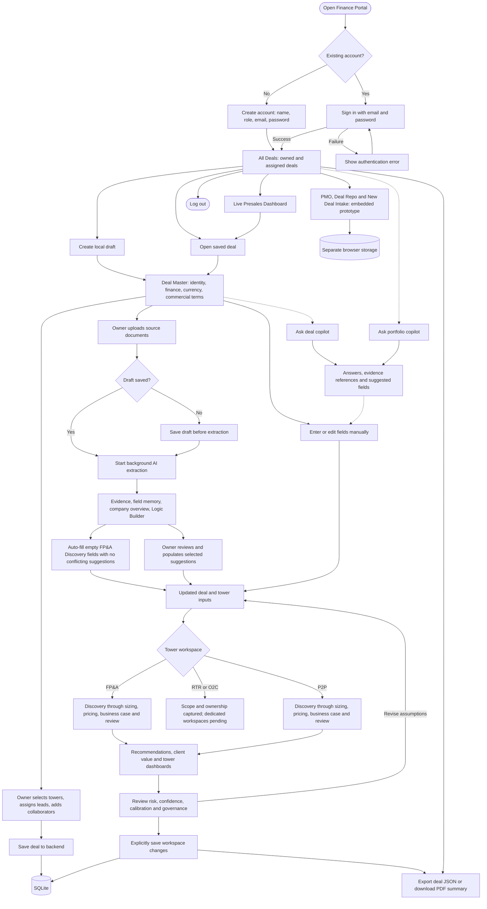
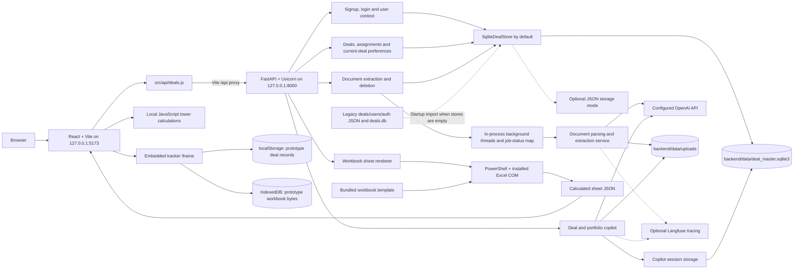
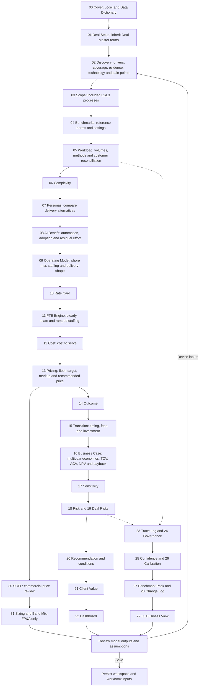
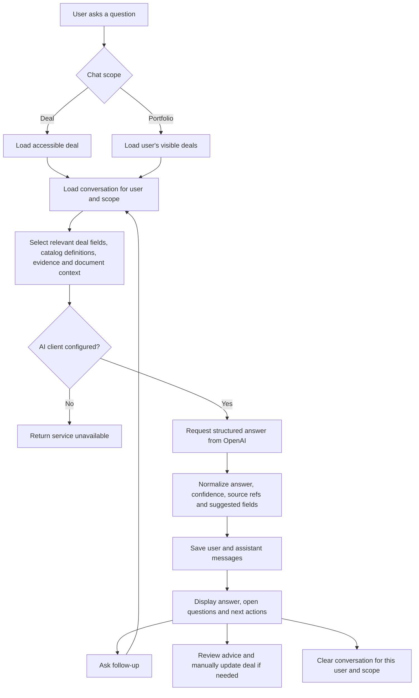
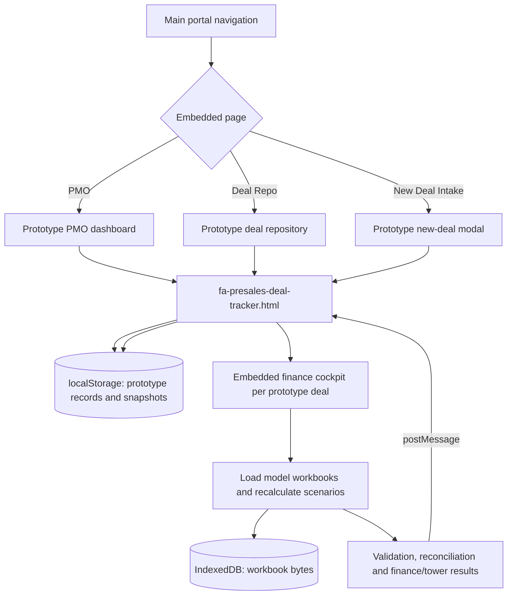

# E2E Finance Portal workflow diagrams

For the document search and extractor import implementation added on 13 November
2026, see [Document knowledge and finance copilot](document-knowledge.md).

This document maps the current implementation reviewed on 6 November 2026. The diagrams describe user actions, data movement, and calculation stages. They do not imply that every stage is a mandatory gate or that the known review findings have been fixed.

Open this file in a Markdown viewer with Mermaid support to render the diagrams.

## 1. Complete user workflow



The main portal's **New Deal** action creates a draft in React state. The sidebar's **New Deal Intake** page opens the separate embedded prototype. Changes in that prototype do not automatically become SQLite deals.

Export is an available action, not an enforced approval step. Copilot suggestions are displayed for review; its chat routes do not automatically update deal fields.

## 2. Runtime and storage architecture



The normal local tower views calculate in JavaScript. Workbook-backed views use the backend renderer and require Windows with Excel installed. AI extraction and copilot require the configured API key and network access. Live extraction status is held in process memory; completed extraction metadata is stored with the deal.

## 3. Sign-in, access and save workflow

```mermaid
sequenceDiagram
    actor User
    participant UI as React application
    participant API as FastAPI
    participant Store as Deal store
    participant DB as SQLite

    UI->>API: GET /api/users
    API-->>UI: Public user directory
    User->>UI: Sign up or sign in
    UI->>API: POST /api/auth/signup or /api/auth/login
    API->>Store: Create password hash or verify password
    Store->>DB: Read/write user and auth records
    API-->>UI: User object
    UI->>UI: Store user ID in localStorage
    Note over UI,API: Current implementation sends X-User-Id; no validated session token
    UI->>API: GET /api/deals with X-User-Id
    API->>Store: Filter deals by owner and membership
    Store-->>UI: Visible deals and current deal ID

    User->>UI: Create draft or edit a deal
    UI->>UI: Update local React state
    User->>UI: Save
    alt New draft
        UI->>API: POST /api/deals
        API->>Store: Set owner, normalize payload, create version 1
    else Existing deal
        UI->>API: PUT /api/deals/{deal_id}
        API->>Store: Check access and allowed fields
        Note over UI,Store: Current tower UI sends the full deal; non-owner saves receive 403
        Note over Store,DB: Owner saves currently have no stale-version conflict check
    end
    alt Request accepted
        Store->>DB: Save deal, sections, collaborators and preferences
        Store-->>UI: Saved deal and updated version
        UI->>UI: Replace local deal with server response
    else Request rejected or unavailable
        API-->>UI: Error
        UI-->>User: Show warning; no successful save
    end
```

| User relationship to a deal | Intended editing scope | Current behavior to account for |
| --- | --- | --- |
| Deal owner | Deal Master, collaborators, all towers, documents, deletion | Supported, but identity is trusted from the request header |
| Assigned tower lead or tower collaborator | Assigned tower workspace and status | UI allows editing; full-deal save payload is rejected by the backend |
| MASTER collaborator | Full deal review | Deal Master remains read-only unless the user is also the owner |
| User without deal membership | No access to that deal | Backend checks membership using the supplied user ID |

Opening a saved deal updates the user's current/recent-deal preferences. Duplication creates a new deal owned by the caller. Deal deletion requires ownership. In-memory edits need an explicit successful save to persist to the shared backend.

## 4. Document extraction and Logic Builder

```mermaid
sequenceDiagram
    actor Owner
    participant UI as React application
    participant API as Documents API
    participant Jobs as DocumentExtractionJobManager
    participant Service as Document intake service
    participant AI as OpenAI API
    participant Disk as Upload directory
    participant Store as Deal store

    Owner->>UI: Select source documents
    opt Deal is a new local draft
        UI->>Store: Save through POST /api/deals
        Store-->>UI: Persisted deal
    end
    UI->>API: POST /api/deals/{deal_id}/documents/extract
    API->>Store: Load deal and check owner
    API->>API: Read uploads into buffered objects
    API->>Jobs: start_job(deal_id, user, uploads, existing_intake)
    alt Active extraction already exists for this deal
        Jobs-->>UI: 409 conflict
    else Run accepted
        Jobs->>Jobs: Store queued run and start daemon thread
        Jobs-->>API: Run metadata
        API-->>UI: 202 with run ID
        Jobs->>Service: process_uploads(..., progress_callback)
        Service->>Service: Validate file count and AI configuration
        loop Each uploaded file
            Service->>Service: Validate bytes; parse and split document context
            Service->>Jobs: Update phase, file name and progress
            Service->>AI: Request structured fields using catalog and prior field memory
            alt Extraction succeeds
                AI-->>Service: Suggestions, evidence and metadata
                Service->>Service: Normalize extraction and source confidence
                Service->>Disk: Store successful source file
                Service->>Service: Merge field memory and company overview
            else File extraction fails
                Service->>Service: Record failed document and continue
            end
        end
        opt Company identified from successful documents
            Service->>AI: Company research request
            AI-->>Service: Research and source references, or warning
        end
        Service-->>Jobs: completed, partial or failed run result
        Jobs->>Store: Reload deal; merge documentIntake; save
        Jobs->>Jobs: Retain final run and saved deal snapshot
        Note over Jobs,Store: Unhandled errors mark the in-memory run failed; final deal save can fail
    end

    loop Every 1.6 seconds until a terminal status
        UI->>API: GET /api/deals/{deal_id}/documents/extract/{run_id}
        API->>Jobs: get_job(deal_id, run_id)
        opt Job absent from memory
            API->>Store: Look for matching persisted latestRun
        end
        API-->>UI: Progress, result or error
    end
    UI->>UI: Load saved extraction result
    UI->>UI: Auto-fill empty FP&A Discovery fields with unambiguous suggestions
    UI->>Store: Save auto-filled deal through PUT /api/deals/{deal_id}
    Owner->>UI: Review document suggestions and Logic Builder fields
    Owner->>UI: Populate selected suggestions
    UI->>Store: Save accepted fields and extraction review metadata
```

Automatic population currently targets `fpaWorkspace.discovery.*` only. Derived controls, populated fields and conflicting suggestions are skipped. Other suggested fields require a review/populate action. Removing a document rebuilds its remaining evidence and review metadata and removes the stored source file; it should not be treated as an automatic rollback of previously populated deal fields.

## 5. Tower analysis and commercial workflow

This is the logical analysis sequence. The tabs can be opened directly, and calculations are recomputed from inputs; the arrows are not a backend job scheduler or an exhaustive formula dependency graph.



FP&A and P2P implement the main tower analysis flow. FP&A additionally has a dedicated Sizing & Band Mix page. RTR and O2C currently have scope/owner metadata and placeholder navigation.

| Tower | Not Started | Ready for Engine | Otherwise |
| --- | --- | --- | --- |
| FP&A | No discovery/coverage/pain answers and scope at workbook defaults | Proxy weighted completeness at least 70%, coverage at least 70%, and at least 4 selected L2 processes | In Progress |
| P2P | No discovery/coverage/pain answers, benchmark/workload/governance edits, notes or populated sheets | At least 10 discovery fields, 5 coverage answers and 1 selected L2 process | In Progress |

These labels describe input readiness. They are not enforced commercial approval or export gates.

## 6. Workbook-backed sheet rendering

```mermaid
flowchart LR
    Tab["Open a workbook-backed tab"] --> Request["POST /api/fpa/workbook/render or /api/p2p/workbook/render"]
    Request --> Validate["Check user context and allowed sheet name"]
    Validate --> Inputs["Map deal fields and explicit workbook inputs to cells"]
    Inputs --> Temp["Copy template to a temporary directory"]
    Temp --> Excel["excel_oracle.ps1 opens Excel COM"]
    Excel --> Apply["Apply inputs and calculate full workbook"]
    Apply --> Read["Read sheet text, formulas and editable-cell metadata"]
    Read --> JSON["Return sheet JSON"]
    JSON --> UI["Render workbook table in React"]
    UI --> Edit["Edit permitted input cells"]
    Edit --> Local["Update local deal workbook inputs"]
    Local --> Request
    Local --> Save["Explicit workspace save persists changes"]
    Validate -->|Invalid sheet| Error["Show error"]
    Excel -->|Excel unavailable or rendering fails| Error
```



This rendering path returns a sheet snapshot. It is separate from downloading an XLSX file. The repository's workbook import/export scripts operate on legacy JSON and specific templates/report files; they are not a general UI export of the current SQLite state.

## 7. Deal and portfolio copilot



Copilot stores its own conversation history. Showing a suggested field does not itself save a new value into the deal.

## 8. Embedded prototype workflow



This prototype owns its browser data and cockpit messaging. The main React wrapper sets the iframe route, styles its layout and can open its intake modal. It does not synchronize prototype deals with the FastAPI deal store. The main **Presales Dashboard** uses live portal deals and is outside this prototype path.

## Known gaps affecting these workflows

These were reproduced during the project review and remain relevant to interpreting the diagrams.

| Area | Current gap | Workflow impact |
| --- | --- | --- |
| Authentication | Public IDs are accepted through `X-User-Id` without a validated session | Login does not provide an effective API identity boundary |
| Tower saves | Non-owner UI submits full deals; workbook input keys are outside the backend allowlist | Assigned FP&A/P2P users receive 403 on save |
| Concurrent editing | Incoming version is discarded instead of checked | An older tab can overwrite newer saved values |
| Extraction runs | Run IDs use second-resolution timestamps | Runs for different deals started in one second can overwrite status/results |
| Startup migration | Empty SQLite deal table triggers legacy re-import | Deleting the final deal can be undone on restart |

## Implementation references

| Workflow | Main implementation |
| --- | --- |
| Navigation, sign-in, draft edits, saves, extraction polling and population | [App.jsx](../src/App.jsx), [API client](../src/api/deals.js) |
| API startup and storage selection | [main.py](../backend/app/main.py), [config.py](../backend/app/config.py) |
| Authentication and request identity | [auth.py](../backend/app/api/auth.py), [dependencies.py](../backend/app/api/dependencies.py), [users.py](../backend/app/api/users.py) |
| Deal operations and permissions | [deals.py](../backend/app/api/deals.py), [storage.py](../backend/app/storage.py), [sqlite_store.py](../backend/app/sqlite_store.py) |
| Uploads, background jobs and review memory | [documents.py](../backend/app/api/documents.py), [document_extraction_jobs.py](../backend/app/services/document_extraction_jobs.py), [document_intake.py](../backend/app/services/document_intake.py), [document_intake_logic.py](../backend/app/services/document_intake_logic.py) |
| Tower tabs and readiness | [fpaWorkspace.js](../src/config/fpaWorkspace.js), [p2pWorkspace.js](../src/config/p2pWorkspace.js), [FpaWorkspacePage.jsx](../src/components/FpaWorkspacePage.jsx), [P2pWorkspacePage.jsx](../src/components/P2pWorkspacePage.jsx) |
| Workbook rendering | [TowerWorkbookSheet.jsx](../src/components/TowerWorkbookSheet.jsx), [workbook_oracle.py](../backend/app/workbook_oracle.py), [excel_oracle.ps1](../backend/app/excel_oracle.ps1) |
| Copilot and sessions | [copilot.py](../backend/app/api/copilot.py), [portal_copilot.py](../backend/app/services/portal_copilot.py), [PortalCopilotWidget.jsx](../src/components/PortalCopilotWidget.jsx) |
| Main portal exports | [dealMaster.js](../src/utils/dealMaster.js), [dealSummaryReport.js](../src/utils/dealSummaryReport.js) |
| Embedded prototype | [EmbeddedTrackerPage.jsx](../src/components/EmbeddedTrackerPage.jsx), [fa-presales-deal-tracker.html](../public/prototypes/fa-presales-deal-tracker.html) |
| Legacy workbook scripts | [import_e2e_workbook_deal.py](../scripts/import_e2e_workbook_deal.py), [export_deal_to_e2e_workbook.py](../scripts/export_deal_to_e2e_workbook.py) |

